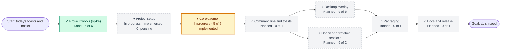

# Toasty Roadmap

**Read the page instead: [ROADMAP.html](ROADMAP.html).** This file is its source.

Visual page: https://cursor.com/canvas/store-99fd6cba-4b27-41a0-8836-790be65a17e8/b9cda125-f568-4339-a7f7-3a26a22019ba

Flow Roadmap format (plain-language layout). Rewritten Nov 11, 2026 from the previous ROADMAP.md (kept as `ROADMAP.md.v1.bak`), [DESIGN.md](DESIGN.md) and [HANDOFF.md](HANDOFF.md). Every old task id, node id and dependency is kept; ids are in small print and in the agent table at the bottom.

## Goal

Start, follow and answer several coding agents from the Linux desktop itself: press a key, type a prompt, and get a card when the agent finishes or needs you. No app to open. v1 shipped. See [DESIGN.md](DESIGN.md).

## Do this next

**Build the command-line client and notifications.**
- Where it stands: the core daemon's five steps and review follow-up are implemented. Direct Codex runs passed; Claude remains quota-limited. The CLI still has a placeholder entry point.
- What's left: connect CLI commands to the socket, then send notifications and route their actions back to the daemon.
- Why: makes the running service usable from the terminal and desktop.
- Who: coding agent.
- Milestone: Command line and toasts · `T24`, then `T25`–`T28`

## Where we are

| Done | Now | Up next | Later |
|---|---|---|---|
| Prove it works (spike): 6 of 6 checks done | Core daemon (5 of 5 steps implemented; pending acceptance) | Command line and toasts (0 of 1 steps) | Desktop overlay (0 of 5) |
| | Project setup (implemented; remote CI pending) | | |
| | | | Codex and watched sessions (0 of 2) |
| | | | Packaging (0 of 1) |
| | | | Docs and release (0 of 1) |

Jasiel accepted the spike results on Nov 11. The six spike tasks are Done. Setup and the core daemon are implemented but remain uncommitted, unmerged and not yet owner-confirmed; their task statuses reflect that. The next card identifies the next engineering work, not a claim that acceptance gates have cleared. Claude cancel and mid-turn messaging remain untried; terminal resume was checked headlessly.

Review follow-up requested in the Nov 11 source-review thread is implemented:

- Controls share a fair loop with output. Queues are bounded, and final state waits for preceding text to save.
- Clean shutdown preserves idle and failed states. History has bounded pages and continuation cursors.
- Hook-based cards show Unknown when recent status is missing. Explicit quota hooks and notifications use Paused.

Direct evidence covers Codex replies, streaming cancel, page cursors, shutdown state,
and a paused notification in Pond. Claude still returned its account-limit error.
Sustained overload and all form types remain unverified. No tests were added or run.

## The journey

Big milestones only. The status word is in every box, not just the color.

Arrows between milestones follow the old step arrows: Desktop overlay and Codex → Packaging come from Peek card and Watched sessions → Packaging. The replay-tests step was dropped on Nov 11 (no-tests rule).

Steps inside each milestone (old node ids, with what each waits for)

- **Prove it works (spike)** (✓ Done, node `M1`): all six tasks accepted by Jasiel on Nov 11. See [results](spike/RESULTS.html) for evidence and untried extras.
- **Project setup**: Project setup (● In progress, `M2.0`, after ACP spike)
- **Core daemon** (● In progress: all five steps implemented; pending acceptance): Backend interface (`M2.1`) · Thread store (`M2.2`) · Approval broker (`M2.3`) · Run control (`M2.5`) · Socket protocol (`M2.4`). Local build/lint and direct Codex flows pass. Claude's quota prevented a fresh successful turn; see DESIGN.md for the exact evidence and limits.
- **Command line and toasts**: CLI and toasts (○ Planned, `M3`, after Socket protocol)
- **Desktop overlay**: Overlay shell (○ Planned, `M5.1`, after CLI and toasts) · Overlay cards (○ Planned, `M5.2`, after Overlay shell) · Summon box (○ Planned, `M5.3`, after Overlay shell) · Thread panel (○ Planned, `M6`, after Summon box) · Peek card (○ Planned, `M7`, after Overlay cards, Thread panel)
- **Codex and watched sessions**: Codex backend (○ Planned, `M8`, after CLI and toasts) · Watched sessions (○ Planned, `M9`, after Codex backend)
- **Packaging**: Packaging (○ Planned, `M10`, after Peek card, Watched sessions) · Replay tests (Dropped, `M4`: no-tests rule)
- **Docs and release**: Docs and release (○ Planned, `M11`, after Packaging)

## Tasks

Buckets: **Do now** (important, urgent) · **Plan it** (important, not urgent) · **Quick hits / hand off** (urgent, not important) · **Later / maybe** (neither). Payoff: Big win / Solid / Small. Size: Quick / Half-day / Big job.

Dependency rule (unchanged): a task waits while any step before its own step is not done, or while a task it needs is open. The spike checks (reopen, kill-and-resume, Codex, approvals) need the prompt-and-reply check; the write-up needs all five.

### Prove it works (spike)

| Task | Status | Bucket | Payoff | Size | Who | Step · id |
|---|---|---|---|---|---|---|
| Get a Claude prompt and its reply over ACP | Done · Owner accepted the reported results Nov 11. | Do now | Big win · unlocks 6 things | Half-day | Coding agent; Jasiel confirms | ACP spike · `M1` · `T1` |
| Reopen the spike session with `claude --resume` | Done · Owner accepted the reported results Nov 11. | Do now | Solid · unlocks 2 things | Quick | Coding agent | ACP spike · `M1` · `T3` |
| Check an approval and an agent question both arrive as requests | Done · Owner accepted the reported results Nov 11. | Do now | Big win · unlocks 2 things | Half-day | Coding agent | ACP spike · `M1` · `T2` |
| Kill the daemon mid-run, then resume the thread | Done · Owner accepted the reported results Nov 11. | Do now | Solid · unlocks 2 things | Half-day | Coding agent | ACP spike · `M1` · `T4` |
| Write the spike results into DESIGN.md | Done · Owner accepted the reported results Nov 11. | Do now | Solid · unlocks 1 thing | Quick | Coding agent | ACP spike · `M1` · `T6` |
| Run Codex's ACP adapter through the same checks | Done · Owner accepted the reported results Nov 11. | Plan it | Solid · unlocks 2 things | Half-day | Coding agent | ACP spike · `M1` · `T5` |

### Project setup

| Task | Status | Bucket | Payoff | Size | Who | Step · id |
|---|---|---|---|---|---|---|
| Create the Rust workspace for `toastyd` and `toasty` | In progress: Implemented and locally verified. All six crates build with --locked, format and lint without warnings. CLI help/version and daemon startup run. Not yet owner-confirmed or merged. | Plan it | Solid · unlocks 1 thing | Quick | Coding agent | Project setup · `M2.0` · `T7` |
| Set up CI to build, lint and check formatting on every push | In progress: Added repository-root .github/workflows/toasty.yml and shared tools/check. Local checks pass on Rust 1.99.1. CI checks Rust 1.90.0 and stable; remote runs await a push. No tests. | Plan it | Solid · unlocks 1 thing | Half-day | Coding agent | Project setup · `M2.0` · `T8` |

### Core daemon

| Task | Status | Bucket | Payoff | Size | Who | Step · id |
|---|---|---|---|---|---|---|
| Define the backend interface | In progress: Implemented. Backend/Session interface connected to per-thread daemon workers. | Plan it | Big win · unlocks 4 things | Half-day | Coding agent | Backend interface · `M2.1` · `T9` |
| Find and launch the pinned adapters; report missing Node | In progress: Implemented. Pinned Claude and Codex adapters installed and launched. Installs serialize per agent; missing Node/npm errors remain explicit. | Plan it | Solid · unlocks 4 things | Half-day | Coding agent | Backend interface · `M2.1` · `T11` |
| Run each adapter in its own process group and kill the whole tree | In progress: Implemented. Separate supervisor stops adapter process groups on daemon death. A direct SIGKILL run left no live processes in the six-process groups. | Plan it | Solid · unlocks 1 thing | Half-day | Coding agent | Backend interface · `M2.1` · `T57` |
| Make Toasty's hooks skip sessions Toasty started (`TOASTY_OWNED=1`) | In progress: Implemented. All hooks skip TOASTY_OWNED=1. Watched cards distinguish missing status from work, and quota hooks/notifications use Paused. Both old spike launchers now set it too; corrected a confirmed stale waiting card in the live dock registry. | Plan it | Solid · unlocks 1 thing | Quick | Coding agent | Backend interface · `M2.1` · `T58` |
| Build the ACP backend: sessions, prompts, streamed updates | In progress: Implemented. ACP sessions, prompts, streamed replies and failure events run through toastyd. Codex exercised live; Claude quota error handled. | Plan it | Big win · unlocks 4 things | Big job | Coding agent | Backend interface · `M2.1` · `T10` |
| Save the session ID at creation, before the first prompt | In progress: Implemented. Session IDs are committed before the first prompt; observed in the live saved thread. | Plan it | Solid · unlocks 1 thing | Quick | Coding agent | Thread store · `M2.2` · `T13` |
| Keep requests open until answered (dismiss is not deny) | In progress: Implemented. Requests have no timeout. Invalid answers and client disconnects leave them open; explicit cancellation or agent withdrawal closes them. | Plan it | Solid · unlocks 1 thing | Quick | Coding agent | Approval broker · `M2.3` · `T17` |
| Lock the socket to the owner and check the caller's user | In progress: Implemented. Owner-only directory/socket, peer UID checks, exclusive runtime/database locks, bounded frames and bounded concurrent client connections implemented. | Plan it | Solid · unlocks 1 thing | Quick | Coding agent | Socket protocol · `M2.4` · `T22` |
| Make the first answer win and update every client | In progress: Implemented. Answers serialize in the thread worker and persist before agent delivery. Two clients raced: one success, one conflict. | Plan it | Big win · unlocks 1 thing | Half-day | Coding agent | Approval broker · `M2.3` · `T16` |
| Write a typed, versioned message schema | In progress: Implemented. Versioned typed command/response/event schema implemented in toasty-proto. | Plan it | Big win · unlocks 1 thing | Half-day | Coding agent | Socket protocol · `M2.4` · `T20` |
| Design the SQLite schema: threads, messages, session IDs | In progress: Implemented. SQLite threads, text chunks, requests and saved settings connected. History uses bounded pages with next_after cursors. Existing schema migrated to version 2. | Plan it | Solid · unlocks 1 thing | Half-day | Coding agent | Thread store · `M2.2` · `T12` |
| Build the request model with typed fields | In progress: Implemented. Typed text, number, integer, boolean, choice, multichoice and URL forms connected. Single-choice form exercised live. | Plan it | Solid · unlocks 1 thing | Half-day | Coding agent | Approval broker · `M2.3` · `T15` |
| Cancel a running turn | In progress: Implemented. Cancel reaches the running agent through a fair loop and returns the thread to idle; exercised after live Codex text arrived. Completion waits for preceding text to save. | Plan it | Solid · unlocks 1 thing | Half-day | Coding agent | Run control · `M2.5` · `T18` |
| Stream thread and request events to subscribers | In progress: Implemented. Socket subscribers receive durable thread/message/request events and tool/usage updates. Lagging clients receive resync_required; slow writes time out. | Plan it | Big win · unlocks 1 thing | Big job | Coding agent | Socket protocol · `M2.4` · `T21` |
| Document the socket protocol in PROTOCOL.md | In progress: Implemented. Daemon socket methods, typed forms, subscriptions, persistence and recovery documented in PROTOCOL.md. | Plan it | Solid · unlocks 1 thing | Half-day | Coding agent | Socket protocol · `M2.4` · `T23` |
| On restart, mark interrupted threads and resume them | In progress: Implemented. Running/waiting threads become interrupted; dead requests withdraw and sessions reopen with saved IDs/settings. Context survived daemon SIGKILL. Clean shutdown now preserves idle/failed states and interrupts only active turns. | Plan it | Solid · unlocks 1 thing | Big job | Coding agent | Thread store · `M2.2` · `T14` |
| Send a message to a running turn | In progress: Implemented. Steering runs separately from the session worker, keeping cancel/approvals serviceable. Exercised live with Codex. | Plan it | Solid · unlocks 1 thing | Big job | Coding agent | Run control · `M2.5` · `T19` |

### Command line and toasts

| Task | Status | Bucket | Payoff | Size | Who | Step · id |
|---|---|---|---|---|---|---|
| Build the CLI: run, ls, reply, approve, panel toggle | Waiting · waits for: Socket protocol | Plan it | Solid · unlocks 2 things | Half-day | Coding agent | CLI and toasts · `M3` · `T24` |
| Send toasts from the daemon over the wire protocol | Waiting · waits for: Socket protocol | Plan it | Solid · unlocks 2 things | Half-day | Coding agent | CLI and toasts · `M3` · `T25` |
| Route notification clicks and replies back to the daemon | Waiting · waits for: Socket protocol | Plan it | Solid · unlocks 2 things | Half-day | Coding agent | CLI and toasts · `M3` · `T26` |
| Add a systemd user unit and start on demand | Waiting · waits for: Socket protocol | Plan it | Solid · unlocks 2 things | Half-day | Coding agent | CLI and toasts · `M3` · `T27` |
| List agents and recent projects for the pickers | Waiting · waits for: Socket protocol | Plan it | Solid · unlocks 2 things | Half-day | Coding agent | CLI and toasts · `M3` · `T28` |

### Desktop overlay

| Task | Status | Bucket | Payoff | Size | Who | Step · id |
|---|---|---|---|---|---|---|
| Send the prompt and close the summon box | Waiting · waits for: Overlay shell | Plan it | Big win · unlocks 1 thing | Quick | Coding agent | Summon box · `M5.3` · `T40` |
| Toggle the overlay from `toasty panel toggle` | Waiting · waits for: CLI and toasts | Plan it | Solid · unlocks 2 things | Quick | Coding agent | Overlay shell · `M5.1` · `T33` |
| Build the standalone Quickshell app skeleton | Waiting · waits for: CLI and toasts | Plan it | Solid · unlocks 2 things | Half-day | Coding agent | Overlay shell · `M5.1` · `T31` |
| Connect the overlay to the socket and subscribe | Waiting · waits for: CLI and toasts | Plan it | Solid · unlocks 2 things | Half-day | Coding agent | Overlay shell · `M5.1` · `T32` |
| Open a thread in the terminal | Waiting · waits for: Summon box | Plan it | Solid · unlocks 1 thing | Quick | Coding agent | Thread panel · `M6` · `T45` |
| Lay out the summon box and its keyboard flow | Waiting · waits for: Overlay shell | Plan it | Big win · unlocks 1 thing | Half-day | Coding agent | Summon box · `M5.3` · `T38` |
| Feed the cards from daemon events | Waiting · waits for: Overlay shell | Plan it | Solid · unlocks 1 thing | Half-day | Coding agent | Overlay cards · `M5.2` · `T35` |
| Measure the 100 ms card budget | Waiting · waits for: Overlay shell | Plan it | Small · unlocks 1 thing | Quick | Coding agent | Overlay cards · `M5.2` · `T37` |
| Build the agent and project pickers | Waiting · waits for: Overlay shell | Plan it | Solid · unlocks 1 thing | Half-day | Coding agent | Summon box · `M5.3` · `T39` |
| Measure the 50 ms summon budget | Waiting · waits for: Overlay shell | Plan it | Small · unlocks 1 thing | Quick | Coding agent | Summon box · `M5.3` · `T41` |
| Build the thread list with live status | Waiting · waits for: Summon box | Plan it | Solid · unlocks 1 thing | Half-day | Coding agent | Thread panel · `M6` · `T42` |
| Build the composer: reply, queue, cancel | Waiting · waits for: Summon box | Plan it | Solid · unlocks 1 thing | Half-day | Coding agent | Thread panel · `M6` · `T44` |
| Peek: show the last reply and a quick reply | Waiting · waits for: Overlay cards, Thread panel | Plan it | Solid · unlocks 1 thing | Half-day | Coding agent | Peek card · `M7` · `T46` |
| Show scrollback with streamed replies | Waiting · waits for: Summon box | Plan it | Big win · unlocks 1 thing | Big job | Coding agent | Thread panel · `M6` · `T43` |
| Show live status of every session in the dock | Waiting · waits for: Overlay shell | Plan it | Solid · unlocks 1 thing | Half-day | Coding agent | Overlay cards · `M5.2` · `T36` |
| Port the agent cards out of the Pond patch | Waiting · waits for: Overlay shell | Plan it | Solid · unlocks 1 thing | Big job | Coding agent | Overlay cards · `M5.2` · `T34` |
| Peek: render typed-field requests | Waiting · waits for: Overlay cards, Thread panel | Plan it | Solid · unlocks 1 thing | Big job | Coding agent | Peek card · `M7` · `T47` |

### Codex and watched sessions

| Task | Status | Bucket | Payoff | Size | Who | Step · id |
|---|---|---|---|---|---|---|
| Show watched sessions in the list, with their limits | Waiting · waits for: Codex backend | Plan it | Solid · unlocks 1 thing | Half-day | Coding agent | Watched sessions · `M9` · `T51` |
| Build the Codex backend (ACP or app-server, per the spike) | Waiting · waits for: CLI and toasts | Plan it | Solid · unlocks 1 thing | Big job | Coding agent | Codex backend · `M8` · `T48` |
| Have the hooks report watched sessions to the daemon | Waiting · waits for: Codex backend | Plan it | Solid · unlocks 1 thing | Big job | Coding agent | Watched sessions · `M9` · `T50` |

### Packaging

| Task | Status | Bucket | Payoff | Size | Who | Step · id |
|---|---|---|---|---|---|---|
| Package for the AUR with a Node check | Waiting · waits for: Peek card, Watched sessions | Plan it | Solid · unlocks 1 thing | Half-day | Coding agent | Packaging · `M10` · `T52` |
| Write an install script for other distributions | Waiting · waits for: Peek card, Watched sessions | Plan it | Solid · unlocks 1 thing | Half-day | Coding agent | Packaging · `M10` · `T53` |
| Update `toasty doctor` for the daemon and overlay | Waiting · waits for: Peek card, Watched sessions | Plan it | Solid · unlocks 1 thing | Half-day | Coding agent | Packaging · `M10` · `T54` |

### Docs and release

| Task | Status | Bucket | Payoff | Size | Who | Step · id |
|---|---|---|---|---|---|---|
| Tag and publish v1 | Waiting · waits for: Packaging | Plan it | Solid · unlocks 1 thing | Quick | Coding agent; Jasiel approves | Docs and release · `M11` · `T56` |
| Rewrite the README for v1 | Waiting · waits for: Packaging | Plan it | Solid · unlocks 1 thing | Half-day | Coding agent | Docs and release · `M11` · `T55` |

## History

- Nov 14: Reworked sidebar contrast and hover details, and notification event hierarchy, safe prose display, bounded expandable details, approval completeness, receiver checks and optional event identity. Direct real-shell captures and disposable action/duplicate checks completed. Full accessibility, narrow display and frontend event matrix remain unverified. Owner authorized source publication to docs/toasty-design. No tests run.

- Nov 14: Cards read native conversation labels by exact session ID, separately from lifecycle reports. Read-only Codex metadata and bounded Claude title records feed a 30-second/on-report refresh. Live named sessions display native titles. Direct isolated hook lifecycle checked; physical interactions and new frontend run remain unverified. No tests, commits or pushes.

- Nov 14: Narrow cards use two title lines, compact status and full-text hover/focus details. First prompt remains stable across follow-ups; legacy duplicate fallbacks are numbered. Titles are excerpts, not inferred summaries. Deployed to Pond; no tests, commits or pushes.

- Nov 14: Hook-card readability/lifecycle cleanup implemented, pending acceptance: separate task/status lines, safe startup fallback, retained real prompt metadata, Ready on Claude creation, stable row positions, one-second terminal settling and honest Ended inference. Exact report dismissal remains intact. Python syntax, QML lint, isolated direct lifecycle/dismissal flow and live development-shell IPC passed; no tests, commits or pushes. Physical interaction and frontend hook coverage remain unverified; see HANDOFF.md.

- Nov 11: Removed app-wide completion acknowledgement, which hid every Done card when one thread opened its app. App cards now clear individually, without age-based hiding. Pointer presses retain the card identity and report snapshot; changed reports are not dismissed on release. Hook reports carry unique revisions, and the locked helper compares the complete report before removing it. Direct live use opened one of three completed cards and left the other two plus the working card visible. A stale dismissal left the newer report unchanged. No tests added or run.

- Nov 11: Refined dock dismissal: × fades in on row hover or keyboard focus, with a transparent resting background and a larger click target. Project text keeps a stable width and uses the space below the control. Keyboard activation and reduced-motion support retained. Installed sidebar reloaded successfully; no tests added or run.

- Nov 11: Fixed undismissable watched-session cards. Added an accessible × control for Done, Paused, Failed and Unknown app cards. Opening Done also dismisses it. The helper removes only the unchanged display report under the registry lock; it does not stop the session. Cleared the four reported Claude cards through the live dock action and confirmed their absence in the live row model. No tests added or run.

- Nov 11: Implemented the three review iterations before stage 4: fair controls, bounded backend queues, ordered completion, shutdown state preservation, paginated history, and consistent watched status. Direct Codex, socket, shutdown and Pond runs are recorded in DESIGN.md. Claude remains quota-limited. No tests, commits or pushes.

- Nov 11: Removed the nonexistent leftover Codex spike row from the live dock. Preserved the owner's rate-limited Claude thread as Paused, added a stationary pause indicator to the source and installed sidebar, and mapped explicit usage-limit failures/notifications to paused in the Claude hook. QML lint and hook syntax pass; Pond reloaded successfully. No tests added or run.

- Nov 11: Implemented all five core daemon steps: connected ACP sessions, SQLite, typed approvals, cancel/steer and the secured streaming socket. Direct Codex flows exercised replies, questions, permissions, competing answers and recovery with context after SIGKILL. No tests added or run. Claude returned its account quota error. Work remains uncommitted and pending acceptance.
- Nov 11: Corrected the old Codex spike session that was stuck Waiting in the desktop dock despite having finished. Spike launchers now set TOASTY_OWNED=1 so they stay out of the hook registry.

- Nov 11: Workspace setup implemented and verified locally on Rust 1.99.1. Centralized shared crate dependencies. Added tools/check and repository-root GitHub Actions for formatting, locked builds and Clippy on Rust 1.90.0 and stable. No tests added or run; remote CI has not run. T7/T8 remain unmerged and not owner-confirmed.

- Nov 11: Jasiel accepted the results ("looks fine to me idk"). Marked T1–T6 Done; moved the next step to workspace setup. Untried Claude cancel and mid-turn messaging remain unverified.

- Nov 11: Plan written: DESIGN.md, ROADMAP.md and HANDOFF.md (uncommitted, branch `docs/toasty-design`).
- Nov 11: Spike started. The first Claude prompt got its reply over ACP at 2:58 PM (not yet confirmed by Jasiel); the approval check and the Codex adapter run started a minute later.
- Nov 11: Roadmap rewritten in the plain-language layout; old version kept as `ROADMAP.md.v1.bak`.
- Nov 11: Owner rule: no tests. Dropped the replay-tests step (`M4`: `T29`, `T30`) and Codex fixtures (`T49`); CI now only builds, lints and checks formatting. The "Packaging and tests" milestone is now "Packaging".
- Nov 11: Codex spike passed; ACP adapter `@agentclientprotocol/codex-acp` 2.6.0 chosen for Codex. Results written into DESIGN.md. Added tasks for process-tree control and for hooks skipping owned sessions.
- Nov 11: Owner asked for HTML pages instead of .md reports. The spike results are now one page: [spike/RESULTS.html](spike/RESULTS.html). This roadmap has a page too: [ROADMAP.html](ROADMAP.html).
- Nov 11: Built the backend crate (interface, ACP backend, adapter installer, process supervisor) and the hooks' skip for owned sessions.
- Nov 11: Daemon work split: the Codex helper builds the thread store and approval broker; Claude builds the backend.
- Nov 11: All four Claude spike checks passed ([results](spike/RESULTS.html)), waiting for Jasiel's OK. Found that Toasty's own hooks also fire inside sessions Toasty starts; fix planned (the daemon sets `TOASTY_OWNED=1` and the hooks skip). Rust workspace started.

## Parked ideas

Out of scope for v1 (from DESIGN.md): diffs and a built-in terminal · agents delegating to other agents · phone or remote access · X11 polish.

## Scoring details (for agents)

Rank = Impact × (1 + Unblocks) ÷ Effort. People never see it. Bucket 1 = Do now, 2 = Plan it, 3 = Quick hits / hand off, 4 = Later / maybe. Node kinds (unchanged): M1, M2.0, M4 and M10 are `infra`; M2.4 is `security`; M7 is `design`; M11 is `docs`; the rest are `feature`.

Old node graph (M4 dropped Nov 11): START → M1 → M2.0 → M2.1; M2.1 → M2.2, M2.3, M2.5, M4; M2.2, M2.3, M2.5 → M2.4 → M3; M3 → M5.1, M8; M5.1 → M5.2, M5.3; M5.3 → M6; M5.2, M6 → M7; M8 → M9; M4, M7, M9 → M10 → M11 → GOAL.

| id | Old name | Node | Milestone | Bucket | Impact | Effort | Unblocks | Rank | Status |
|---|---|---|---|---|---|---|---|---|---|
| T1 | Spike: Claude prompt and reply over ACP | M1 | Prove it works (spike) | 1 | 5 | 2 | 6 | 17.5 | done |
| T3 | Spike: reopen the session with `claude --resume` | M1 | Prove it works (spike) | 1 | 4 | 1 | 2 | 12.0 | done |
| T2 | Spike: approval and question arrive as requests | M1 | Prove it works (spike) | 1 | 5 | 2 | 2 | 7.5 | done |
| T4 | Spike: kill the daemon mid-run, then resume | M1 | Prove it works (spike) | 1 | 4 | 2 | 2 | 6.0 | done |
| T6 | Write the spike results into DESIGN.md | M1 | Prove it works (spike) | 1 | 3 | 1 | 1 | 6.0 | done |
| T57 | Process group per adapter; kill the whole tree | M2.1 | Core daemon | 2 | 4 | 2 | 1 | 4.0 | implemented, pending acceptance |
| T58 | Hooks skip owned sessions (`TOASTY_OWNED=1`) | M2.1 | Core daemon | 2 | 4 | 1 | 1 | 8.0 | implemented, pending acceptance |
| T9 | Define the backend interface | M2.1 | Core daemon | 2 | 5 | 2 | 4 | 12.5 | implemented, pending acceptance |
| T11 | Find and launch pinned adapters; report missing Node | M2.1 | Core daemon | 2 | 4 | 2 | 4 | 10.0 | implemented, pending acceptance |
| T40 | Send the prompt and close the summon box | M5.3 | Desktop overlay | 2 | 5 | 1 | 1 | 10.0 | blocked |
| T33 | Toggle the overlay from `toasty panel toggle` | M5.1 | Desktop overlay | 2 | 3 | 1 | 2 | 9.0 | blocked |
| T10 | ACP backend: sessions, prompts, streamed updates | M2.1 | Core daemon | 2 | 5 | 3 | 4 | 8.3 | implemented, pending acceptance |
| T13 | Save the session ID at creation, before the first prompt | M2.2 | Core daemon | 2 | 4 | 1 | 1 | 8.0 | implemented, pending acceptance |
| T17 | Requests wait until answered; dismiss is not deny | M2.3 | Core daemon | 2 | 4 | 1 | 1 | 8.0 | implemented, pending acceptance |
| T7 | Create the Rust workspace for `toastyd` and `toasty` | M2.0 | Project setup | 2 | 3 | 1 | 1 | 6.0 | in progress |
| T22 | Owner-only socket with caller user check | M2.4 | Core daemon | 2 | 3 | 1 | 1 | 6.0 | implemented, pending acceptance |
| T24 | CLI: run, ls, reply, approve, panel toggle | M3 | Command line and toasts | 2 | 4 | 2 | 2 | 6.0 | blocked |
| T25 | Daemon sends toasts over the wire protocol | M3 | Command line and toasts | 2 | 4 | 2 | 2 | 6.0 | blocked |
| T26 | Route notification clicks and replies back to the daemon | M3 | Command line and toasts | 2 | 4 | 2 | 2 | 6.0 | blocked |
| T31 | Standalone Quickshell app skeleton | M5.1 | Desktop overlay | 2 | 4 | 2 | 2 | 6.0 | blocked |
| T32 | Overlay connects to the socket and subscribes | M5.1 | Desktop overlay | 2 | 4 | 2 | 2 | 6.0 | blocked |
| T45 | Open a thread in the terminal | M6 | Desktop overlay | 2 | 3 | 1 | 1 | 6.0 | blocked |
| T56 | Tag and publish v1 | M11 | Docs and release | 2 | 3 | 1 | 1 | 6.0 | blocked |
| T16 | First answer wins; update every client | M2.3 | Core daemon | 2 | 5 | 2 | 1 | 5.0 | implemented, pending acceptance |
| T20 | Typed, versioned message schema | M2.4 | Core daemon | 2 | 5 | 2 | 1 | 5.0 | implemented, pending acceptance |
| T38 | Summon box layout and keyboard flow | M5.3 | Desktop overlay | 2 | 5 | 2 | 1 | 5.0 | blocked |
| T5 | Spike: Codex's ACP adapter through the same checks | M1 | Prove it works (spike) | 2 | 3 | 2 | 2 | 4.5 | done |
| T27 | systemd user unit and start on demand | M3 | Command line and toasts | 2 | 3 | 2 | 2 | 4.5 | blocked |
| T28 | List agents and recent projects for the pickers | M3 | Command line and toasts | 2 | 3 | 2 | 2 | 4.5 | blocked |
| T12 | SQLite schema: threads, messages, session IDs | M2.2 | Core daemon | 2 | 4 | 2 | 1 | 4.0 | implemented, pending acceptance |
| T15 | Request model with typed fields | M2.3 | Core daemon | 2 | 4 | 2 | 1 | 4.0 | implemented, pending acceptance |
| T18 | Cancel a running turn | M2.5 | Core daemon | 2 | 4 | 2 | 1 | 4.0 | implemented, pending acceptance |
| T29 | Record real ACP sessions as fixtures | M4 | Packaging | 2 | 4 | 2 | 1 | 4.0 | dropped |
| T35 | Feed cards from daemon events | M5.2 | Desktop overlay | 2 | 4 | 2 | 1 | 4.0 | blocked |
| T37 | Measure the 100 ms card budget | M5.2 | Desktop overlay | 2 | 2 | 1 | 1 | 4.0 | blocked |
| T39 | Agent and project pickers | M5.3 | Desktop overlay | 2 | 4 | 2 | 1 | 4.0 | blocked |
| T41 | Measure the 50 ms summon budget | M5.3 | Desktop overlay | 2 | 2 | 1 | 1 | 4.0 | blocked |
| T42 | Thread list with live status | M6 | Desktop overlay | 2 | 4 | 2 | 1 | 4.0 | blocked |
| T44 | Composer: reply, queue, cancel | M6 | Desktop overlay | 2 | 4 | 2 | 1 | 4.0 | blocked |
| T46 | Peek: last reply and quick reply | M7 | Desktop overlay | 2 | 4 | 2 | 1 | 4.0 | blocked |
| T21 | Subscribe: stream thread and request events | M2.4 | Core daemon | 2 | 5 | 3 | 1 | 3.3 | implemented, pending acceptance |
| T43 | Scrollback with streamed replies | M6 | Desktop overlay | 2 | 5 | 3 | 1 | 3.3 | blocked |
| T8 | CI: build, lint and format check on every push | M2.0 | Project setup | 2 | 3 | 2 | 1 | 3.0 | blocked |
| T23 | Document the socket protocol in PROTOCOL.md | M2.4 | Core daemon | 2 | 3 | 2 | 1 | 3.0 | implemented, pending acceptance |
| T36 | Dock: live status of every session | M5.2 | Desktop overlay | 2 | 3 | 2 | 1 | 3.0 | blocked |
| T49 | Record Codex fixtures and add them to replay | M8 | Codex and watched sessions | 2 | 3 | 2 | 1 | 3.0 | dropped |
| T51 | Show watched sessions in the list, with their limits | M9 | Codex and watched sessions | 2 | 3 | 2 | 1 | 3.0 | blocked |
| T52 | AUR package with a Node check | M10 | Packaging | 2 | 3 | 2 | 1 | 3.0 | blocked |
| T53 | Install script for other distributions | M10 | Packaging | 2 | 3 | 2 | 1 | 3.0 | blocked |
| T54 | Update `toasty doctor` for the daemon and overlay | M10 | Packaging | 2 | 3 | 2 | 1 | 3.0 | blocked |
| T55 | Rewrite the README for v1 | M11 | Docs and release | 2 | 3 | 2 | 1 | 3.0 | blocked |
| T14 | On restart, mark interrupted threads and resume them | M2.2 | Core daemon | 2 | 4 | 3 | 1 | 2.7 | implemented, pending acceptance |
| T30 | Replay fixtures through the daemon in CI | M4 | Packaging | 2 | 4 | 3 | 1 | 2.7 | dropped |
| T34 | Port the agent cards out of the Pond patch | M5.2 | Desktop overlay | 2 | 4 | 3 | 1 | 2.7 | blocked |
| T47 | Peek: render typed-field requests | M7 | Desktop overlay | 2 | 4 | 3 | 1 | 2.7 | blocked |
| T48 | Codex backend: ACP or app-server, per the spike | M8 | Codex and watched sessions | 2 | 4 | 3 | 1 | 2.7 | blocked |
| T19 | Send a message to a running turn | M2.5 | Core daemon | 2 | 3 | 3 | 1 | 2.0 | implemented, pending acceptance |
| T50 | Hooks report watched sessions to the daemon | M9 | Codex and watched sessions | 2 | 3 | 3 | 1 | 2.0 | blocked |
